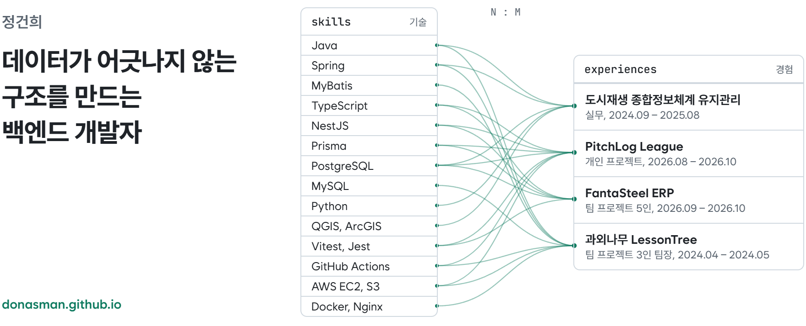

<a href="https://donasman.github.io">
  <picture>
    <source media="(prefers-color-scheme: dark)" srcset="./assets/banner-dark.png">
    
  </picture>
</a>

공공 도시재생 정보시스템을 12개월간 유지보수하며, 약 3,000만 건 규모의 연간 데이터 갱신을 다시 실행해도 같은 결과가 나오도록 재설계했습니다. 이후 개인·팀 프로젝트에서 트랜잭션과 잠금, 멱등 적재, 외부 API 보호, 백업과 롤백까지 직접 설계하고 운영했습니다.

사례별 문제와 해결 과정은 [포트폴리오 사이트](https://donasman.github.io)에 정리했습니다. 연락은 [rjsgmlq33@gmail.com](mailto:rjsgmlq33@gmail.com)으로 주세요.

## 프로젝트

### [PitchLog League](https://github.com/donasman/pitchlog-league)

개인 프로젝트, 2026.08 – 2026.10, [서비스 보기](https://pitchlog-league.vercel.app)

유럽 5대 리그와 UEFA 대회, 국내 컵까지 19개 대회의 경기·선수 데이터를 외부 API에서 모아 보여 주는 축구 데이터 서비스입니다. 기획부터 운영까지 혼자 맡았습니다. 첫 버전은 Spring Boot와 Spring Batch로 만들어 운영했고, 회고를 거쳐 NestJS와 Prisma로 다시 설계했습니다.

- 행 단위 upsert를 테이블당 한 문장의 `INSERT … ON CONFLICT`로 묶어 기초 데이터 적재를 200초에서 71초로 줄였습니다(DB 리전 이전 효과 포함).
- 하루 7,500콜 한도 안에서 메시지 큐 없이 DB 커서로 백필해 경기 13,724건을 무인으로 적재했습니다.
- 라이브 스코어 역행은 조건부 UPDATE로, 즐겨찾기 동시 저장 충돌은 advisory lock으로 막았습니다.
- 테스트 480개(실제 PostgreSQL에서 도는 E2E 191개 포함)를 통과해야 병합되도록 CI를 구성했습니다.

**스택** NestJS, TypeScript, Prisma, PostgreSQL(Supabase), React, AWS EC2와 S3, Vercel

### [FantaSteel ERP](https://github.com/SteelFlowLLM/fantasteel-erp)

K-뉴딜 아카데미 팀 프로젝트(5인), 2026.09 – 2026.10

원료 입고부터 출하까지 일관제철 공정을 다루는 철강 제조 협업 ERP입니다. 팀의 백엔드 기반(스키마, 공통 모듈, 모듈별 구현 가이드)을 맡았고, 구매, MRP, 조직, 업무 알림 모듈을 직접 구현했습니다.

- ERD를 Prisma 스키마(44개 모델)로 옮기고, 16개 모듈 중 15개의 구현 가이드를 써서 팀원들이 같은 기준으로 구현하게 했습니다.
- 입고를 확정할 때 상위 발주 행을 `FOR UPDATE`로 잠가, 동시에 들어온 입고가 발주 수량을 넘지 않게 했습니다.
- 트랜잭션 안에서 겹치던 쿼리 789회를 찾아내 구매 전 구간에서 0회로 고정했습니다.
- API 31개와 서버 테스트 약 120개를 작성하고, 팀 PR 216개 중 124개를 병합했습니다.

**스택** NestJS, Prisma, PostgreSQL, Jest

### [과외나무 LessonTree](https://github.com/test-2024-0402-team4)

코리아IT아카데미 팀 프로젝트(3인, 팀장), 2024.04 – 2024.05

학생과 선생님을 이어 주는 과외 매칭 웹 서비스입니다.

- GitHub Actions, Docker, Nginx로 블루/그린 무중단 배포를 구성했습니다. 새 버전이 헬스체크를 통과해야 트래픽을 넘깁니다.
- 지역, 과목, 요일, 학생 유형 조건을 MyBatis 동적 SQL로 조합한 다중 조건 검색을 만들었습니다.
- 이슈 187개, PR 172개 중 65개를 작성하고 152개를 병합하며 팀 작업 흐름을 운영했습니다.

**스택** Java 11, Spring Boot 2.6, MyBatis, MySQL, AWS EC2와 S3

## 경력

### 도시재생 종합정보체계 유지관리

프리랜서(주임), 응용SW개발, 2024.09 – 2025.08

주택도시보증공사 도시재생 종합정보체계의 백엔드 유지보수와 연 단위 데이터 갱신을 맡았습니다. 건축물대장 약 3,000만 건 갱신 작업을 처리 단위로 나누고 저장 시점을 기록하게 바꿔, 중간에 멈춰도 처음부터 다시 돌리지 않게 했습니다. 다음 해 갱신에도 같은 코드를 이어서 썼습니다.

**스택** Java(Spring Legacy), PostgreSQL, Python, QGIS, ArcGIS

## 지금 하는 것

- K-뉴딜 아카데미 수강 중(2026.08부터)
- AI-Byte-Club 스터디에서 『주니어 백엔드 개발자가 반드시 알아야 할 실무 지식』을 챕터별로 토론하고 있습니다. DB 인덱스, 동시성, 인증과 암호화를 다룹니다.
