<a href="https://donasman.github.io">
  <picture>
    <source media="(prefers-color-scheme: dark)" srcset="./assets/banner-dark.svg">
    
  </picture>
</a>

  
  
  
  

## 🛠️ 기술 스택

<table>
  <tr><td><b>Backend</b></td><td> &nbsp;MyBatis</td></tr>
  <tr><td><b>Database</b></td><td></td></tr>
  <tr><td><b>Infra · CI/CD</b></td><td></td></tr>
  <tr><td><b>Test</b></td><td></td></tr>
  <tr><td><b>Data · GIS</b></td><td> &nbsp;QGIS, ArcGIS</td></tr>
  <tr><td><b>Frontend</b></td><td></td></tr>
  <tr><td><b>Tools</b></td><td></td></tr>
</table>

## 💼 경력과 프로젝트

| | 이름 | 구분 | 기간 | 코드 |
|:-:|:--|:--|:--|:-:|
| 🏙️ | [도시재생 종합정보체계 유지관리](https://donasman.github.io/#work) | 실무, 프리랜서(주임) | 2024.09 – 2025.08 | |
| ⚽ | [PitchLog League](https://donasman.github.io/#pitchlog) | 개인 프로젝트 | 2026.08 – 2026.10 | [GitHub](https://github.com/donasman/pitchlog-league) |
| 🏭 | [FantaSteel ERP](https://donasman.github.io/#fantasteel) | 팀 5인, 백엔드 기반 설계 | 2026.09 – 2026.10 | [GitHub](https://github.com/SteelFlowLLM/fantasteel-erp) |
| 🌳 | [과외나무 LessonTree](https://donasman.github.io/#lessontree) | 팀 3인, 팀장 | 2024.04 – 2024.05 | [GitHub](https://github.com/test-2024-0402-team4) |

이름을 누르면 포트폴리오 사이트에서 문제와 해결 과정을 볼 수 있어요.

## 📊 활동

  
  

## 🌱 지금 하는 것

- 🎓 K-뉴딜 아카데미 수강 중 (2026.08부터)
- 📖 AI-Byte-Club 스터디: 『주니어 백엔드 개발자가 반드시 알아야 할 실무 지식』 챕터별 토론
